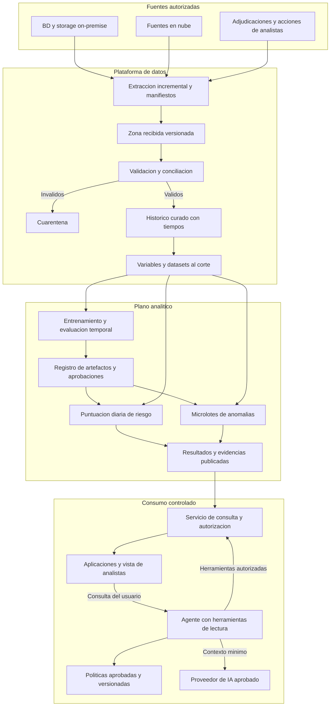
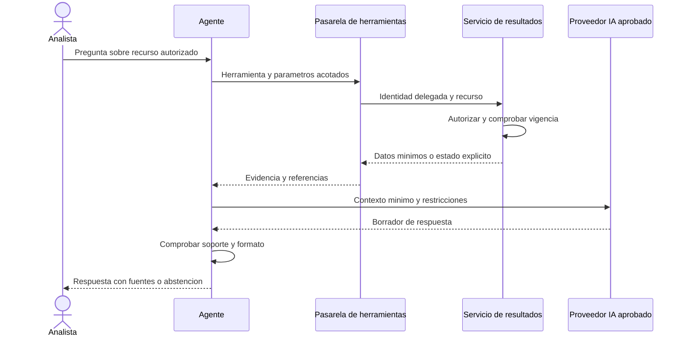

# 02 · Arquitectura de la solución

**Prueba técnica:** Data Scientist Senior — Hitss Colombia — Gerencia Analítica  
**Versión:** 1.0 · **Fecha:** 7 de noviembre de 2026  
**Destino en GitHub:** `docs/02_arquitectura.md`  
**Dependencia:** [01 · Entendimiento del negocio](01_entendimiento_negocio.md)  
**Estado:** arquitectura propuesta; no implementada, desplegada ni validada con datos reales.

## 1. Decisión ejecutiva

Se propone una arquitectura híbrida de extracción controlada, procesamiento incremental y publicación de resultados almacenados. Riesgo crediticio se recalcularía diariamente; anomalías se procesarían en microlotes posteriores a la transacción. Ambos flujos compartirían capacidades de datos y gobierno, manteniendo separados sus objetivos, etiquetas, permisos y versiones.

Las aplicaciones y el agente consultarían una capa de resultados mediante servicios autorizados. Consultar un score no desencadenaría entrenamiento ni cálculo sobre los sistemas transaccionales. El agente sería de solo lectura, con herramientas acotadas y acceso limitado por usuario y recurso.

Se elige una arquitectura lógica concreta y un stack de referencia portable: SQL y Python para transformaciones y modelos tabulares; almacenamiento de objetos para históricos y artefactos; motor SQL para resultados; trabajos en contenedores para entrenamiento y puntuación; orquestación, identidad y gestión de secretos administradas por la plataforma del banco. El proveedor de nube se mantiene pendiente de confirmar. Esta es una decisión de portabilidad y reutilización, no una afirmación de equivalencia entre productos de nube.

La parte 2 define estructura, responsabilidades, límites de confianza, flujos y decisiones. Las especificaciones detalladas de datos, algoritmos, configuraciones, APIs y monitoreo corresponden a P03–P09.

## 2. Requisitos y supuestos de arquitectura

Se conservan las marcas de P01: **R** requisito del enunciado, **S** supuesto pendiente, **P** parámetro propuesto y **ND** no disponible. Todos los tiempos, capacidades y condiciones de servicio siguientes son propuestas de diseño, no mediciones ni acuerdos.

| Condición | Tratamiento en arquitectura |
|---|---|
| R03: nube y fuentes on-premise | Extracción desde réplicas, exportaciones o conectores autorizados; evitar consultas analíticas sobre el core |
| R05–R06: dos modelos | Trabajos y artefactos distintos para riesgo y anomalías/fraude |
| R08/R10: agente y resultados accionables | Servicio de consulta, evidencias y políticas; explicaciones con contexto temporal |
| R11–R13: versiones, promoción y cambios | Registro de artefactos, aprobación y despliegue de versiones identificables |
| R14–R18: consumo, permisos y monitoreo | API controlada, autorización por recurso, métricas de servicio/datos/modelos |
| S03: tiempos de disponibilidad reconstruibles | Conservar `event_time`, `available_at`, ingesta y versión de cada fuente |
| S06: fraude adjudicado disponible | Rama supervisada opcional; anomalía no se transforma en fraude por ausencia de etiquetas |
| S07: capacidad humana de revisión | Colas con capacidad K acordada y trazabilidad de diferidos |
| S09: proveedor de IA aprobado | Pasarela de IA con minimización; alternativa por plantillas si no hay aprobación |
| S12: un producto y un canal | Particiones y permisos preparados para extender cobertura tras validación |

No están disponibles volumen diario, tamaño de registros, concurrencia, retención, nube, presupuesto ni topología de red. Por ello no se fija número de máquinas, tamaño de base de datos, factura ni capacidad garantizada.

## 3. Vista general de componentes

Identidad, secretos, cifrado, catálogo/linaje, auditoría y observabilidad son capacidades transversales. No se dibujan como un paso final: deben aplicarse a cada almacenamiento, trabajo y consulta. El registro de acciones y adjudicaciones lo realiza el sistema de casos autorizado; el agente no escribe en él.

### 3.1 Responsabilidades y límites

| Componente lógico | Responsabilidad / entrada → salida | Límite explícito |
|---|---|---|
| Adaptadores de fuentes | Exportaciones o cambios autorizados → lotes con manifiesto | No modifican el core ni incorporan credenciales al código |
| Ingesta | Validar recepción y registrar origen → histórico recibido | No decide etiquetas ni corrige silenciosamente datos |
| Validación | Esquemas, identidad, duplicados, tiempos y conciliación → válido/cuarentena | No publica lotes incompletos como si fueran completos |
| Histórico curado | Datos normalizados y versiones → consultas reproducibles | Una corrección no borra su fecha de conocimiento |
| Constructor de variables | Histórico y corte → variables disponibles en ese instante | No consume eventos o adjudicaciones futuros |
| Constructor de etiquetas | Resultados adjudicados y seguimiento → etiquetas con madurez | No llama negativo a lo desconocido |
| Entrenadores/evaluadores | Dataset congelado y configuración → candidato e informe | No promocionan automáticamente su propio candidato |
| Registro y liberación | Artefactos, validación y aprobaciones → versión autorizada | Un alias mutable no reemplaza la identificación de versión |
| Trabajos de puntuación | Datos al corte y versión aprobada → resultados candidatos | No escriben directamente en la vista pública antes de validarla |
| Publicador | Resultados validados → generación visible y consistente | No mezcla versiones sin identificarlas |
| Servicio de consulta | Identidad y recurso solicitado → salida mínima autorizada | No expone SQL libre, tablas históricas ni rutas de artefactos |
| Agente | Pregunta y herramientas permitidas → respuesta fundamentada | No calcula PD por texto ni ejecuta decisiones sensibles |
| Observabilidad | Métricas, eventos y trazas → alertas y evidencias de operación | Drift no equivale automáticamente a pérdida de desempeño |

## 4. Datos híbridos y consistencia temporal

### 4.1 Extracción e ingreso

Preferencia propuesta: reutilizar exportaciones o réplicas existentes y autorizadas. Para riesgo, una extracción diaria conciliada puede ser suficiente. Para anomalías, la viabilidad de microlotes dependerá de la frecuencia real de entrega del canal. Si la fuente llega cada hora, no se afirmará detección de extremo a extremo en quince minutos.

Cada lote incluiría origen, identificador, rango de tiempos, esquema, número de registros, control de integridad, fecha de extracción y estado de completitud. Cuando sea posible, se conciliarán cantidades y sumas de control con la fuente. Los extractores usarían permisos de lectura, límites de carga y ventanas pactadas.

La captura de cambios se consideraría si existe una capacidad aprobada y aporta valor. No se presupone que todas las bases admitan CDC ni que pueda habilitarse sin impacto. Las exportaciones completas siguen siendo una alternativa para fuentes pequeñas, con costos y ventanas evaluados.

### 4.2 Zonas de almacenamiento

| Zona | Contenido | Regla propuesta |
|---|---|---|
| Recibida | Datos de origen y manifiestos | Versiones conservadas durante retención aprobada; acceso restringido |
| Cuarentena | Registros/lotes inválidos y motivos | No alimenta scoring; remediación con responsable |
| Curada | Identidades resueltas, eventos y correcciones | Distinguir fecha del hecho y fecha de conocimiento |
| Variables/etiquetas | Tablas al corte y snapshots de evaluación | Separar etiquetas de variables disponibles para puntuar |
| Artefactos | Modelos, configuración, entorno y evaluaciones | Identificación por versión y huella; acceso segregado |
| Resultados | Scores, alertas, factores y referencias | Consulta por recursos autorizados; estado de vigencia explícito |

“Versionado” no significa retención infinita. Retención, eliminación, bloqueos legales y tratamiento de copias/respaldos requieren política aprobada. La seudonimización no convierte automáticamente los datos en anónimos; la tabla de correspondencias debe tener acceso separado.

### 4.3 Disponibilidad al corte y reprocesamiento

Para reconstruir una decisión al tiempo `t`, se usaría exclusivamente información cuyo evento y disponibilidad fueran anteriores o iguales a `t`. Deben distinguirse disponibilidad operativa original y fecha de ingesta actual; si no puede reconstruirse la primera, declarar la limitación del backtest.

Una corrección recibida mañana no se incorpora retrospectivamente como si se hubiera conocido ayer. Se puede recalcular un histórico corregido, pero debe identificarse como nueva versión y distinguirse de lo efectivamente servido.

Se propone entrega **al menos una vez**, con procesamiento idempotente: cada operación conserva una clave de origen y versión; cada trabajo identifica dataset, corte, modelo y configuración. Reintentar el mismo lote no crea transacciones ni alertas duplicadas. No se promete procesamiento exactamente una vez entre sistemas heterogéneos.

Datos tardíos activan una política de reapertura o de corrección, definida en P03. Los límites de tardanza y los controles de orden entre eventos se medirán por fuente; no se inventa una tolerancia universal.

## 5. Tres flujos separados

### 5.1 Entrenamiento y validación

1. Construir un snapshot con corte, fuentes y etiquetas maduras identificables.
2. Ejecutar transformaciones versionadas y controles de fugas temporales.
3. Entrenar baselines y candidatos con configuración registrada.
4. Evaluar fuera de tiempo, por segmentos y capacidad, según P04/P05.
5. Registrar artefacto, dependencias, informe, limitaciones y huellas.
6. Solicitar validación y aprobación; desplegar únicamente una versión autorizada.

El trabajo conserva versión de datos, código/configuración, esquema de variables, etiqueta, periodo, entorno, semilla cuando aplique y métricas. Reproducibilidad significa reconstrucción auditable bajo dependencias controladas; no se promete igualdad bit a bit sin demostrar determinismo.

### 5.2 Puntuación diaria de riesgo

El orquestador espera el cierre y la conciliación de fuentes obligatorias, construye variables y aplica el modelo aprobado. Verifica cobertura, valores, versión y conteos antes de publicar una generación completa. La publicación sería mediante cambio atómico de referencia o transacción compatible con el almacén elegido.

Si el lote falla, la generación anterior sigue disponible únicamente con su fecha y estado de vigencia. Si supera el límite de antigüedad aprobado, la consulta devuelve `desactualizado` o `no_disponible`. No se cambia silenciosamente a otro modelo ni se devuelve riesgo bajo por ausencia de datos.

La propuesta de P01 de tener el resultado antes de las 08:00, America/Bogota, depende del cierre real. P03 debe medir disponibilidad y P06 presupuestar cada etapa antes de formalizar ese objetivo.

### 5.3 Anomalías posteriores a la transacción

Se propone evaluar microlotes cada cinco minutos como punto inicial (P), sujeto a disponibilidad, costo y carga. El objetivo de P01 de quince minutos se mide desde disponibilidad completa; además se informaría la demora desde la transacción para no ocultar retrasos de origen.

Descomposición propuesta: espera de microlote hasta 5 minutos, variables/puntuación hasta 7 y publicación/aviso hasta 3. Es un presupuesto de diseño, no una medición p95 ni una garantía estadística. La prueba de carga deberá validar la distribución de extremo a extremo.

Cada transacción recibe score y versión; solo las elegibles se ordenan para la cola de revisión. La prioridad considera política aprobada, capacidad K y deduplicación de casos. Diferidos, descartados por capacidad y operaciones no evaluables quedan registrados. El sistema no bloquea pagos.

## 6. Consumo, API y agente

La capa de consulta expone recursos de riesgo histórico, alertas y evidencias mínimas. Las rutas definitivas, paginación, errores y contratos corresponden a P08. Arquitectónicamente se exige:

- Identidad autenticada y autorización sobre cada cliente/caso/producto solicitado.
- Separación de acceso a resultados y acceso a datos de origen.
- Respuestas con corte, horizonte, versión, vigencia, calidad e identificador de trazabilidad.
- Límites de consultas, paginación y prevención de enumeración masiva.
- Compatibilidad versionada para aplicaciones consumidoras.
- Distinción de errores de acceso, inexistencia y obsolescencia sin revelar recursos ajenos.

Un score almacenado permite responder sin volver a ejecutar el modelo. El objetivo propuesto de p95 ≤1 segundo aplica a esa consulta, con carga y concurrencia por medir; no al tiempo completo del agente ni al scoring diario.

La identidad del usuario se transmite mediante un mecanismo verificable y acotado; no basta con incluir un identificador en el texto del prompt. Las credenciales de la herramienta no deben dar acceso irrestricto en nombre del agente.

El agente recupera políticas aprobadas con versión y vigencia. Una base vectorial no es obligatoria: un catálogo y búsqueda textual pueden bastar para pocas políticas. Si se usa recuperación semántica, sus índices, permisos y eliminación deben seguir los de los documentos fuente.

Los datos recuperados son evidencia, no instrucciones. Se aplican restricciones de herramientas, validación de parámetros y salida, minimización y pruebas de inyección. Comprobar formato o referencias no garantiza veracidad: la fundamentación exige evaluación humana y casos de prueba, según P08. Si la IA falla, la consulta directa y las plantillas siguen disponibles.

## 7. Seguridad y fronteras de confianza

El enfoque propuesto aplica autorización explícita por recurso. NIST SP 800-207 establece que la ubicación de red o la propiedad del activo no otorgan confianza implícita; estar dentro de una red privada no basta para autorizar una consulta. Referencia: [NIST — Zero Trust Architecture](https://www.nist.gov/publications/zero-trust-architecture).

| Frontera | Amenaza principal | Control propuesto y evidencia a validar |
|---|---|---|
| On-premise → nube | Extracción excesiva, pérdida o credenciales expuestas | Canal cifrado aprobado, identidad técnica acotada, manifiestos y auditoría |
| Datos recibidos → curados | Corrupción, esquema inesperado o contaminación | Contratos, conciliación, cuarentena y aprobación de correcciones |
| Desarrollo → producción | Artefactos o configuraciones no autorizados | Separación de identidades, huellas, revisión y promoción controlada |
| Aplicación → resultados | Acceso a otros clientes o extracción masiva | Autorización por objeto, mínimos privilegios, límites y pruebas negativas |
| Agente → herramientas | Confusión de identidad y ejecución arbitraria | Lista permitida, parámetros tipados, identidad delegada y sin SQL libre |
| Evidencia → contexto IA | Instrucciones maliciosas o datos excesivos | Tratar texto como datos, minimizar contexto y restringir herramientas |
| Plataforma → proveedor IA | Exfiltración o retención no autorizada | Proveedor/ruta aprobados, condiciones de tratamiento y filtro de campos |
| Operación → registros | Datos sensibles en logs | Redacción, acceso restringido y retención; no registrar prompts íntegros por defecto |

Propuesta de roles: ingeniería lee fuentes autorizadas y publica datos curados; ciencia de datos usa datasets aprobados y registra candidatos; validación revisa evidencia; identidad de liberación despliega versiones aprobadas; analistas consultan solo su ámbito; agentes acceden únicamente mediante herramientas. Los permisos administrativos se gestionan por un proceso separado y auditable.

Se propone cifrado en tránsito y reposo con gestión de claves y secretos fuera del código. Redes privadas y controles de salida se concretarán con la topología del banco. Toda excepción necesita propietario, alcance, vencimiento y revisión. No se afirma cumplimiento legal o certificación de seguridad con este diseño.

## 8. Entornos, artefactos y entrega

| Entorno propuesto | Datos y uso | Condición de paso |
|---|---|---|
| Desarrollo | Datos sintéticos o conjuntos autorizados minimizados; experimentación | Validaciones de contrato, revisión y artefactos identificables |
| Validación / preproducción | Datos autorizados representativos, controles de acceso y carga | Informe analítico, integración, seguridad y recuperación aprobados |
| Producción / piloto | Cobertura y usuarios aprobados; servicio observado | Versión, configuración, permisos y riesgo residual aprobados |

Separar por cuentas/proyectos o fronteras equivalentes según la plataforma; no basta usar carpetas con nombres distintos. Secretos, identidades y escritura en resultados se segregan. Las aprobaciones y artefactos se promocionan por referencia; los datos sensibles no se copian entre entornos por comodidad.

Unidad de liberación propuesta: modelo + transformaciones + contrato de variables + entorno de ejecución + política de umbrales + configuración de servicio. Compatibilidad y huellas deben verificarse juntas. No seleccionar dependencias mediante una etiqueta mutable de “última versión”. P06 definirá versiones fijadas y configuración; P07 detallará estados y promoción.

## 9. Fallas y recuperación

| Escenario | Respuesta propuesta | Lo que se conserva / verifica |
|---|---|---|
| Fuente no llega o no concilia | No publicar nueva generación; alertar al propietario | Último resultado con antigüedad explícita y límites de uso |
| Lote duplicado / reintento | Reconocer clave y versión; evitar efecto duplicado | Registro de intento, manifiesto y estado |
| Registro inválido | Cuarentena o bloqueo de lote según criticidad acordada | Motivo, conteos y cobertura excluida |
| Scoring falla a mitad | Reintentar particiones idempotentes; publicar solo generación válida | Artefacto, corte y partes completadas |
| Nueva versión degrada | Retirar publicación y restaurar combinación compatible aprobada | Modelo, variables y política; no solo archivo del modelo |
| Esquema incompatible | Detener consumo afectado y avisar | Datos originales y contrato incumplido |
| Agente/proveedor IA falla | Consulta directa, respuesta por plantilla o abstención | Identificador de incidente; sin inventar explicación |
| API o almacén no disponibles | Error explícito, reintento acotado y proceso operativo alternativo | No sustituir el error por un score por defecto |
| Acceso indebido detectado | Suspender identidad/función afectada, preservar evidencia y activar respuesta | Auditoría minimizada conforme al proceso del banco |

Objetivos preliminares para negociar: recuperar consulta de resultados en ≤4 horas y perder como máximo 24 horas de resultados de riesgo reconstruibles (P). Para alertas se propone reconstrucción desde la fuente en ≤4 horas, conservando marcas de posición y evitando casos duplicados. Estos objetivos no garantizan recuperación de acciones humanas: expedientes y adjudicaciones necesitan política de respaldo propia, por acordar. Si los objetivos de continuidad del banco son más exigentes, deberá rediseñarse redundancia y recuperación antes del piloto.

Respaldar no demuestra recuperabilidad. P06/P09 deberán incluir restauración probada, tiempos observados, dependencias de identidad/red/claves y compatibilidad de versiones. Los objetivos RTO/RPO definitivos siguen pendientes.

## 10. Escalabilidad, performance y costo

El diseño empieza con trabajos acotados y reutilización de servicios existentes. Particionar por fecha/canal y distribuir por claves que eviten concentrar toda la carga en una partición. El paralelismo y sus límites se fijarán con pruebas; una sola transacción o cliente no debería causar lectura completa del histórico.

Variables para dimensionar, todas ND: `V` transacciones/día, `C` clientes elegibles, `B` bytes por registro, `F` número/tamaño de variables, `Q` consultas por segundo, retención `T`, factor pico y tiempo disponible `W`.

Estimaciones de diseño, no resultados:

- Entrada diaria aproximada: `V × B`, más fuentes no transaccionales y metadatos.
- Histórico recibido: entrada diaria × días retenidos, ajustado por compresión y versiones medidas; no asumir un factor fijo.
- Rendimiento mínimo de riesgo: `C / W` clientes por segundo, más margen a definir para reintentos y variabilidad.
- Capacidad de microlote: eventos del intervalo y pico observado divididos por tiempo útil de procesamiento.
- Cola humana: tiempo de llegada y servicio; `K × tiempo medio por caso` no puede superar minutos disponibles sin plan de acumulación.

Costos a incluir en P10: extracción y red híbrida, almacenamiento/respaldos, transformaciones, entrenamiento, puntuación, consulta, monitoreo, identidad/seguridad, soporte, IA por uso, adjudicación y revisión humana. Distribuir costos fijos y variables; no tratar modelos baratos de inferir como solución necesariamente barata de operar.

Separar entrenamiento y servicio evita que un experimento consuma la capacidad de consulta. Una tienda de variables en línea, bus de eventos o clúster distribuido se añadirá solo si las pruebas muestran necesidad. La existencia de dos modelos no implica por sí sola necesitar esas plataformas.

La separación entre puntuación por lotes y consumo en línea tiene precedentes en documentación oficial; por ejemplo, Microsoft distingue despliegues batch para inferencia asíncrona. Esto respalda el patrón, no selecciona ese producto ni prueba sus prestaciones para este banco: [Microsoft — What are batch endpoints?](https://learn.microsoft.com/en-us/azure/machine-learning/concept-endpoints-batch).

## 11. Registro de decisiones de arquitectura

Todas las decisiones están **propuestas**, pendientes de ratificación según acceso, gobierno y dimensionamiento.

| ID | Decisión | Alternativa descartada inicialmente / motivo | Riesgo aceptado y disparador de revisión |
|---|---|---|---|
| AR01 | Extraer a plataforma analítica con conectores autorizados | Consultar core desde cada modelo/agente: acoplamiento y carga | Aceptar demora de extracción; revisar si una decisión exige baja latencia |
| AR02 | Riesgo diario, anomalías por microlotes y consulta de resultados almacenados | Todo síncrono: complejidad sin requisito confirmado | Aceptar detección posterior; revisar si negocio exige intervención previa |
| AR03 | Histórico temporal y snapshots versionados | Sobrescribir estado actual: dificulta reconstrucción | Mayor almacenamiento; ajustar retención sin perder obligaciones de auditoría |
| AR04 | SQL/Python y trabajos en contenedores sobre plataforma existente | Clúster dedicado y múltiples frameworks desde inicio | Capacidad inicial por medir; escalar con evidencia |
| AR05 | Variables materializadas y código compartido/versionado | Feature store en línea inicial: costo y operación adicionales | Menor inmediatez; reconsiderar si varios consumidores necesitan variables en línea |
| AR06 | Almacén SQL de resultados detrás de servicio controlado | Acceso directo de consumidores al lago: permisos y contratos frágiles | Costo de duplicar vista de resultados; revisar volumen y patrones |
| AR07 | Registro de modelos y aprobaciones, tecnología concreta en P07 | Archivos con nombres manuales o alias sin versión: poca trazabilidad | Operación de registro adicional; priorizar servicio existente |
| AR08 | Autorización por recurso y herramientas acotadas | Confiar en red interna o prompt: controles insuficientes | Complejidad de permisos; no relajar por facilidad de demo |
| AR09 | Agente de lectura con consulta directa/plantillas de respaldo | Acciones autónomas: mayores consecuencias y alcance | Menor automatización; ampliar solo con caso y gobierno propios |
| AR10 | Idempotencia y publicación validada | Prometer exactamente una vez de extremo a extremo | Más metadatos; probar reintentos y correcciones |
| AR11 | Proveedor de nube sin fijar hasta confirmar restricciones | Elegir marca sin conocer plataforma: integración y costo inciertos | Menor detalle de recursos físicos en P02; concretar en P06 tras Q04 |
| AR12 | Recuperación de conjunto compatible de artefactos | Rollback solo del modelo: puede romper variables/políticas | Más coordinación de liberación; verificar en pruebas |

Candidatos de implementación a comparar posteriormente, sin adopción implícita: orquestador corporativo o trabajos administrados; catálogo/registro corporativo o MLflow; API Python como FastAPI o estándar del banco; motor SQL existente o servicio administrado compatible. La elección final debe documentar propietario, integración, licencias, costo, soporte y prueba necesaria. No se fijan versiones de librerías sin validar el entorno.

## 12. Trazabilidad y criterios de aceptación de P02

| Requisitos de P01 | Respuesta en este documento | Evidencia pendiente |
|---|---|---|
| R01–R04: productivo, ciclo completo, híbrido y escalable | §§3–5, 9–10 | Conectividad, contratos y pruebas de carga |
| R05–R10: dos modelos, fuentes, agente, justificación y acción | §§3–6 | Protocolos P03–P05 y contratos P08 |
| R11–R13: estados, entrega y cambios confiables | §§5, 8–9 | Gobierno P07 y manuales P09 |
| R14–R15: integración y acceso controlado | §§6–7 | Contrato y pruebas de autorización P08 |
| R16–R18: monitoreo, degradación y cambios | §§4, 9–10 | Métricas, umbrales e incidentes P09 |
| R19–R20/R23/R27–R28: organización, repetibilidad y entornos | §§3, 8, 11 | Interfaces y configuración P06 |
| R24/R26/R31–R32/R35: decisiones, costo, métricas y defensa | §§2, 9–11 | Estimaciones P10, sustentación P12 |

Criterios documentales cubiertos: límites de componentes y confianza; flujo híbrido; separación entrenamiento/puntuación/consulta; temporalidad e idempotencia; manejo de fallas; entornos y promoción; seguridad del agente; decisiones y alternativas; variables de dimensionamiento y dependencias.

No se marcan como verificados: acceso real a fuentes, ausencia de fugas, desempeño, autorizaciones efectivas, disponibilidad, recuperación, factura ni beneficios. Requieren implementación/pruebas posteriores o validación documental adicional según el alcance de la prueba.

Antes de aprobar esta arquitectura para un piloto deberán resolverse: producto/canal y etiqueta (Q01–Q03), conectividad y permisos (Q04), reconstrucción temporal (Q05), capacidad de revisión (Q07), latencia real de negocio (Q08), aprobadores (Q10) y proveedor de IA (Q11). Volumen, concurrencia y continuidad deben medirse/acordarse para dimensionar.

## 13. Próxima entrega e incorporación en GitHub

La siguiente parte es **P03 · Fuentes, contratos, calidad y variables temporales**. Debe concretar inventario por fuente, campos obligatorios, resolución de identidades, tiempos, reglas de conciliación, manejo de correcciones, ventanas y construcción de etiquetas maduras. Se podrán usar contratos y ejemplos sintéticos identificados; no se afirmará que las fuentes existen sin confirmación.

Guardar este documento como `docs/02_arquitectura.md`, junto al archivo de P01 para conservar el enlace relativo. Revisar los diagramas Mermaid en la vista previa del repositorio y guardar un commit, por ejemplo `docs: definir arquitectura hibrida y decisiones`. Agregar su enlace al índice del README cuando se cree. No se ha publicado ni modificado un repositorio remoto.

**Declaración de integridad:** arquitectura de referencia para una prueba técnica. No contiene implementación, datos de clientes, resultados de modelos ni aprobación del banco. Las referencias externas fundamentan principios concretos; las elecciones, parámetros y compromisos propuestos son responsabilidad de este diseño y requieren validación.
