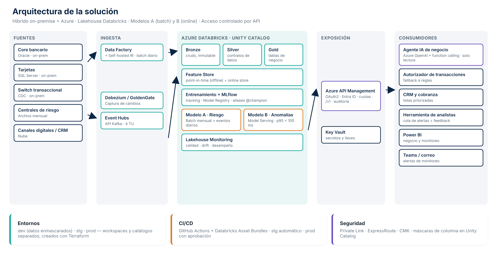

# Plataforma de Riesgo Dinámico y Detección de Anomalías Transaccionales

**Prueba técnica – Data Scientist Senior – Hitss Colombia – Gerencia Analítica**
Autor: Carlos Soler Bedoya

> "El valor no está solo en predecir, sino en explicar la lógica y hacer accionable el resultado."

---

## 1. Qué resuelve esta solución

Un banco colombiano quiere pasar de reportes descriptivos a **modelos predictivos operando en producción**, consumidos por un **agente de IA** y por los sistemas del negocio. Esta propuesta diseña dos modelos y todo su ciclo de vida:

| | Modelo A – Riesgo financiero dinámico | Modelo B – Comportamiento transaccional atípico |
|---|---|---|
| Pregunta de negocio | ¿Qué clientes se van a deteriorar **antes** de caer en mora? | ¿Qué transacciones son fraude, abuso o riesgo **ahora**? |
| Tipo | Behavioral scoring (PD 90+ días a 12 meses) | Híbrido: supervisado (fraude conocido) + no supervisado (patrones nuevos) |
| Frecuencia | Batch mensual + recálculo diario por eventos | Casi tiempo real (p95 < 100 ms) |
| Acción que habilita | Cobranza preventiva, ajuste de cupos, provisiones, preaprobados | Bloqueo/step-up, cola priorizada de analistas |
| Valor estimado (supuesto) | ~COP 4.800 M/año | ~COP 5.500 M/año |

Detalle del caso de negocio: [`docs/07_costos_y_caso_de_negocio.md`](docs/07_costos_y_caso_de_negocio.md)



## 2. Cómo navegar este repositorio

El enunciado indica que **no se requiere implementar el código**, sino plantear componentes y clases. Por eso:
- `src/` contiene **el esqueleto**: clases, firmas, docstrings y contratos. Algunas funciones críticas (p. ej. PSI) están implementadas para ilustrar el criterio.
- `docs/` contiene **el razonamiento**: supuestos, decisiones (ADRs), ciclo de vida, monitoreo, costos y sustentación.

| Para entender... | Lea |
|---|---|
| Supuestos del ejercicio | [`docs/01_supuestos.md`](docs/01_supuestos.md) |
| Arquitectura y flujo de datos | [`docs/02_arquitectura.md`](docs/02_arquitectura.md) |
| Modelos, variables y métricas | [`docs/03_modelos.md`](docs/03_modelos.md) |
| Versionado, estados y promoción | [`docs/04_ciclo_de_vida.md`](docs/04_ciclo_de_vida.md) |
| Monitoreo y drift | [`docs/05_monitoreo.md`](docs/05_monitoreo.md) |
| APIs y agente IA | [`docs/06_consumo_api_agente.md`](docs/06_consumo_api_agente.md) |
| Costos y caso de negocio | [`docs/07_costos_y_caso_de_negocio.md`](docs/07_costos_y_caso_de_negocio.md) |
| Plan, equipo, tiempos y aceleradores | [`docs/08_plan_equipo_tiempos.md`](docs/08_plan_equipo_tiempos.md) |
| Presión por salir antes, alternativas, riesgos | [`docs/09_sustentacion.md`](docs/09_sustentacion.md) |
| Seguridad, gobierno y regulación | [`docs/10_seguridad_gobierno.md`](docs/10_seguridad_gobierno.md) |
| Decisiones de arquitectura | [`docs/adr/`](docs/adr/) |
| Fichas de los modelos | [`docs/model_cards/`](docs/model_cards/) |
| Mockups de salidas | [`docs/img/`](docs/img/) |
| Presentación | [`docs/Presentacion_Prueba_Hitss.pptx`](docs/Presentacion_Prueba_Hitss.pptx) |

## 3. Estructura

```
risk-fraud-platform/
├── api/openapi.yaml              # Contrato de las APIs (v1)
├── configs/                      # base + override por entorno, features, umbrales, monitoreo
├── docs/                         # Razonamiento, ADRs, model cards, mockups, presentación
├── infra/terraform/              # Infraestructura como código (dev / stg / prod)
├── pipelines/                    # Databricks Asset Bundle: jobs de entrenamiento, scoring y monitoreo
├── src/riskfraud/
│   ├── common/                   # Configuración, logging, contratos
│   ├── ingestion/                # Conectores on-prem (batch) y streaming (CDC)
│   ├── data_quality/             # Validación de contratos de datos
│   ├── features/                 # Construcción de variables point-in-time + Feature Store
│   ├── models/                   # BaseModel, RiskScoreModel, HybridAnomalyModel
│   ├── evaluation/               # Métricas técnicas y de negocio, matriz de costos
│   ├── explainability/           # SHAP + traducción a razones de negocio
│   ├── lifecycle/                # Registro, compuertas de promoción, champion/challenger
│   ├── serving/                  # API online (FastAPI) y scoring batch
│   ├── monitoring/               # Drift, desempeño, alertas
│   └── agent/                    # Herramientas (tools) que consume el agente IA
├── tests/                        # Unitarios, contratos de datos, pruebas de modelo
└── .github/workflows/            # CI (cada PR) y CD (stg automático, prod con aprobación)
```

## 4. Principios de diseño

1. **Negocio primero**: cada modelo tiene una acción y un KPI financiero asociados.
2. **Explicable por diseño**: toda predicción sale con sus 3 razones principales (requisito SFC y de usabilidad).
3. **Reproducible**: cada score se puede reconstruir (código + datos + features + config + modelo ligados por `run_id`).
4. **Costo proporcional al valor**: solo B es tiempo real; A es batch.
5. **Humano en el bucle**: el agente IA explica y recomienda; no decide crédito ni bloquea productos.

## 5. Ejecución local (opcional)

```bash
make setup      # crea entorno e instala dependencias + pre-commit
make test       # corre pruebas unitarias
make lint       # ruff + mypy
```
