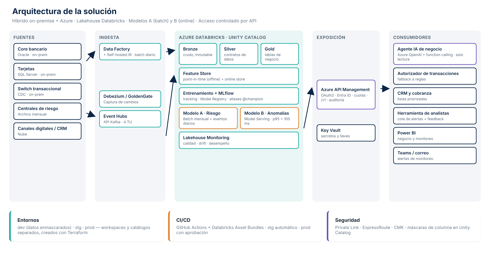

# 02 · Arquitectura

## Flujo de extremo a extremo

1. **Ingesta**
   - *Batch on-prem* (core, tarjetas, centrales): Azure Data Factory + **Self-hosted Integration Runtime** dentro de la red del banco. Carga incremental diaria a Bronze.
   - *Streaming* (transacciones): **CDC** (Debezium / Oracle GoldenGate) → **Azure Event Hubs** (API Kafka) → Databricks Structured Streaming.
2. **Lakehouse (Databricks + Unity Catalog)** con capas medallion:
   - **Bronze**: dato crudo, inmutable, auditable.
   - **Silver**: dato limpio, tipado, deduplicado, con **contratos de datos** validados (`data_quality/`).
   - **Gold**: tablas de negocio: `cliente_mes`, `transaccion_enriquecida`, `scores_riesgo`, `alertas_fraude`.
3. **Feature Store** (Databricks Feature Engineering): variables con **joins point-in-time** para entrenamiento sin fuga y **online store** para el modelo B.
4. **Entrenamiento** en jobs efímeros, con tracking y registro en **MLflow + Unity Catalog Model Registry**.
5. **Serving**
   - Modelo A: **scoring batch** → tabla Gold + API de consulta.
   - Modelo B: **Databricks Model Serving** (endpoint con autoescalado).
6. **Exposición**: **Azure API Management** como única puerta (OAuth2/Entra ID, cuotas, versionado).
7. **Consumidores**: agente IA (Azure OpenAI con function calling), CRM/cobranza, motor de autorización, Power BI.
8. **Monitoreo**: Lakehouse Monitoring + Azure Monitor + tablero Power BI + alertas a Teams/correo.

## Por qué esta arquitectura

| Decisión | Razón | ADR |
|---|---|---|
| Lakehouse en Databricks | Un solo lugar para datos, features, entrenamiento, registro y serving; gobierno unificado con Unity Catalog | [0001](adr/0001-lakehouse-databricks.md) |
| A batch, B online | El riesgo crediticio no cambia en milisegundos; el fraude sí. Pagar tiempo real solo donde genera valor | [0002](adr/0002-batch-vs-online.md) |
| Fraude híbrido | Lo supervisado no ve patrones nuevos; lo no supervisado solo genera demasiadas alertas | [0003](adr/0003-fraude-hibrido.md) |
| MLflow + aliases | Promoción y rollback en minutos, trazabilidad para auditoría | [0004](adr/0004-registro-y-promocion.md) |
| API Management | Acceso controlado, consumidores múltiples, contratos versionados | [0005](adr/0005-api-management.md) |
| Agente solo lectura | Riesgo regulatorio y reputacional de decisiones automáticas por LLM | [0006](adr/0006-agente-ia-solo-lectura.md) |

## Escalabilidad y performance
- **Streaming**: Event Hubs con particiones por `cliente_id` (orden por cliente); 4 Throughput Units soportan los picos supuestos (400 tps) con holgura.
- **Online features**: lectura < 10 ms desde el online store; presupuesto total de latencia de B: 100 ms p95.
- **Batch A**: 2 M clientes × ~150 variables se califican en < 30 min en un cluster de 8 nodos.
- **Crecimiento**: horizontal en todas las capas (particiones, autoescalado de clusters y endpoints).
