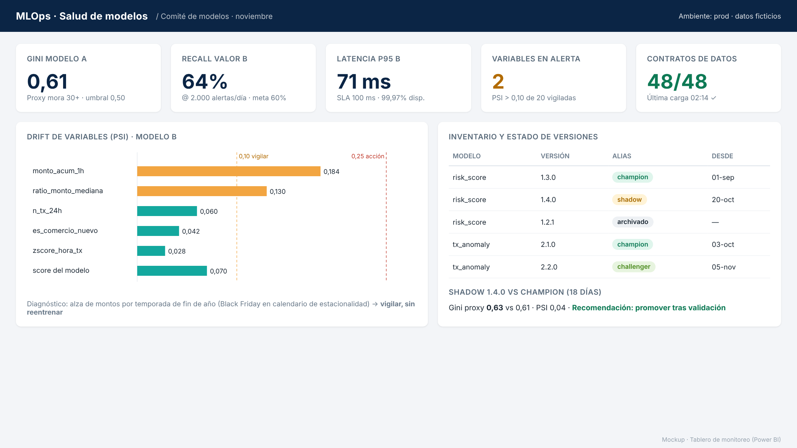

# 05 · Monitoreo y control

## Cuatro capas

| Capa | Qué se mide | Herramienta | Alerta |
|---|---|---|---|
| 1. Servicio | Latencia p50/p95/p99, errores 5xx, disponibilidad, throughput | Azure Monitor / App Insights | p95 > 100 ms 5 min; error > 1% |
| 2. Datos | Esquema, nulos, volumen, frescura, rangos | `data_quality/validator.py` + Lakehouse Monitoring | Contrato roto → detiene pipeline |
| 3. Drift | PSI por variable y del score; distribución de predicciones | `monitoring/drift.py` | PSI 0,10-0,25 aviso · > 0,25 acción |
| 4. Desempeño y negocio | Gini, recall, valor detectado, falsos positivos, mora por banda | `monitoring/performance.py` + Power BI | Ver `configs/monitoring.yaml` |

## El problema de las etiquetas tardías
El desempeño real no se conoce de inmediato:
- **Modelo A**: la mora 90+ tarda hasta 12 meses en materializarse.
- **Modelo B**: los contracargos tardan 30-60 días.

**Solución**: indicadores tempranos (*proxies*) que correlacionan con el target final:

| Modelo | Proxy temprano | Disponible en |
|---|---|---|
| A | Mora 30+ a 3 meses por banda | 3 meses |
| A | Rodamiento de cartera (0→30, 30→60) por banda | 1 mes |
| B | Confirmación del analista sobre alertas revisadas | 1-2 días |
| B | Reclamos del cliente sobre transacciones aprobadas | 7-15 días |

## Anticipación (lo que pide la prueba)
- **Drift antes que degradación**: el drift de entrada se ve en días; la degradación del desempeño en meses. Se actúa sobre el primero.
- **Monitoreo por segmento**, no solo global: un modelo puede estar bien en promedio y fallar en un segmento (p. ej. independientes, nueva región).
- **Calendario conocido**: quincenas, prima de diciembre, Black Friday → umbrales de alerta estacionales para no generar falsas alarmas.
- **Revisión mensual** en comité de modelos con el tablero.

## Runbook ante alerta
1. Alerta llega a Teams + ticket automático.
2. On-call de ML revisa tablero (¿datos? ¿drift? ¿servicio?).
3. Si es dato: se corrige la fuente; scoring usa último valor válido.
4. Si es drift real: se lanza reentreno → shadow → promoción.
5. Si el modelo daña negocio: **rollback** inmediato y postmortem.
