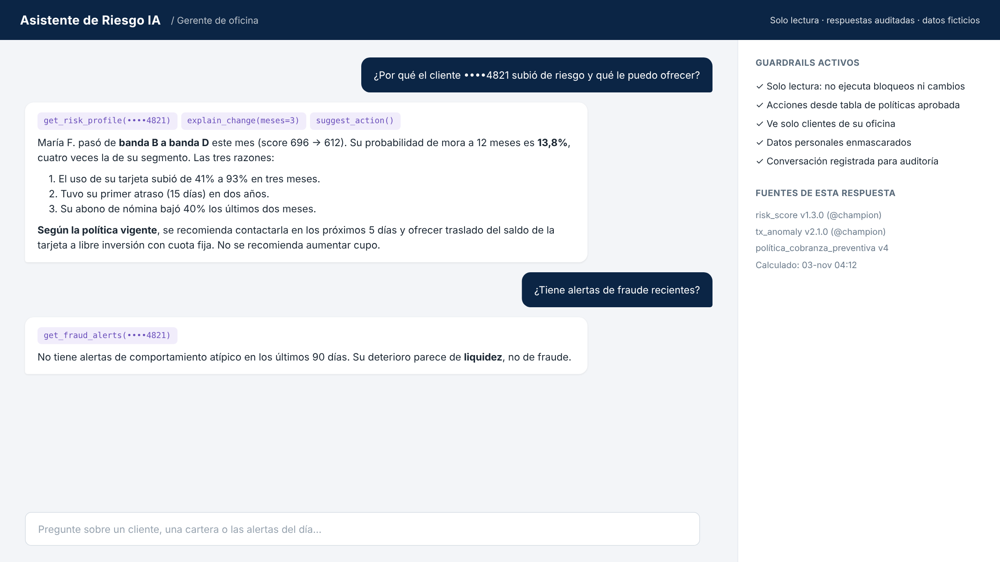

# 06 · Consumo por sistemas y agente IA

## APIs (contrato en [`api/openapi.yaml`](../api/openapi.yaml))

| Endpoint | Modelo | Modo | Consumidores |
|---|---|---|---|
| `GET /v1/risk/clients/{cliente_id}` | A | Lectura de tabla Gold (score vigente) | Agente, CRM, cobranza, originación |
| `GET /v1/risk/clients/{cliente_id}/history` | A | Lectura | Agente, Power BI |
| `POST /v1/fraud/score` | B | Inferencia online | Autorizador, canales digitales |
| `GET /v1/fraud/alerts?estado=pendiente` | B | Lectura | Herramienta de analistas, agente |
| `POST /v1/fraud/alerts/{id}/feedback` | B | Escritura (etiqueta del analista) | Herramienta de analistas |

**Azure API Management** aplica:
- Autenticación OAuth2 (Entra ID) por aplicación consumidora; *scopes* por endpoint.
- Cuotas y rate limiting por consumidor.
- Versionado en ruta (`/v1/`, `/v2/`) — nunca se rompe un consumidor existente.
- Logs de cada consulta para auditoría (quién consultó qué cliente y cuándo).
- Enmascaramiento de campos según el consumidor.

## Agente IA de negocio

**Arquitectura**: Azure OpenAI (GPT) con *function calling* → herramientas en `src/riskfraud/agent/tools.py` → APIs anteriores.

| Herramienta | Qué hace |
|---|---|
| `get_risk_profile(cliente_id)` | Score, banda, tendencia y razones |
| `explain_change(cliente_id, meses)` | Explica por qué cambió el riesgo |
| `get_fraud_alerts(cliente_id)` | Alertas recientes y su estado |
| `portfolio_summary(segmento)` | Resumen de cartera por banda/segmento |
| `suggest_action(cliente_id)` | Acción sugerida según política aprobada (tabla de reglas, no inventada por el LLM) |

**Casos de uso**
- Gerente de oficina: "¿Por qué el cliente X subió de riesgo y qué le puedo ofrecer?"
- Analista de fraude: "Resúmeme las alertas críticas de hoy por monto."
- Gerente de riesgo: "¿Cómo se movió la banda D en tarjetas este mes?"

**Guardrails**
- **Solo lectura**: el agente no ejecuta bloqueos, cambios de cupo ni aprobaciones.
- Las acciones sugeridas vienen de una **tabla de políticas aprobada**, no de la generación libre del LLM.
- Datos personales enmascarados en prompts y logs; ningún dato sale del tenant del banco.
- Autorización heredada del usuario: el agente solo ve los clientes que el usuario puede ver.
- Registro completo de conversaciones para auditoría; evaluación periódica de calidad de respuestas.
